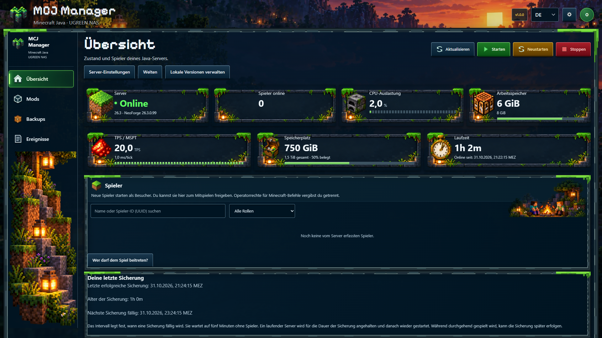

# MCJ Manager

[Deutsch](#deutsch) · [English](#english)

Serververwaltung für Minecraft Java auf UGREEN NAS. Server, Spieler, Mods und Backups im Browser verwalten.
Server management for Minecraft Java on UGREEN NAS. Manage your server, players, mods and backups in your browser.

**Version 1.0.1**

## Deutsch

### Was brauche ich?

- UGREEN NAS mit UGOS und installierter Docker-App. Die Anwendung ist für Intel/AMD-NAS (`linux/amd64`) vorgesehen.
- Heimnetz-IP des NAS, zum Beispiel `192.168.1.50`.
- Zum Mitspielen: ein Computer mit Minecraft Java Edition und einem zum Server passenden Minecraft-Client. Jeder Spieler benötigt ein eigenes berechtigtes Minecraft-Konto; die NAS-Anwendung enthält keine Spiellizenz.
- Vorhandener Docker-Ordner, zum Beispiel `/volume1/docker`, und freier Speicher für Minecraft und Backups.
- Einen aktuellen Browser und eine erreichbare E-Mail-Adresse. Für die sichere Anmeldung kannst du entweder einen Code per E-Mail oder eine Authenticator-App verwenden. Für E-Mail-Codes richtest du während der Installation deinen Mailversand ein.

Für die normale Installation brauchst du weder SSH noch eine Konsole.

### Installation über UGOS Docker

**Schritt für Schritt mit Bildern:** [PDF auf Deutsch](docs/Installation-DE.pdf) · [Textanleitung](docs/INSTALLATION-DE.md).

1. Lade [ugos-einrichtung.yaml](deploy/ugos-einrichtung.yaml) herunter.
2. Öffne **UGOS → Docker → Projekt → Erstellen**. Verwende `mcj_einrichtung` als Namen und einen eigenen, leeren Speicherordner für das Einrichtungsprojekt. Importiere die YAML-Datei.
3. Setze `NAS_IP` auf die IP deines NAS und `NAS_ORDNER` auf deinen vorhandenen Docker-Ordner. Falls UGOS kein Variablenfeld anbietet, ersetze die beiden Platzhalter direkt in der angezeigten Konfiguration. Das genaue Vorgehen steht in der Installationsanleitung.
4. Starte das Projekt. Öffne in **UGOS → Dateien** den neu angelegten Ordner `mcj-einrichtung` im gewählten Docker-Ordner. Dort liegen Einrichtungscode und öffentliches Heimnetz-Zertifikat.
5. Richte das Vertrauen für `Heimnetz-Zertifikat.crt` nach der [HTTPS-Anleitung](docs/HTTPS.md) ein. Öffne danach `https://DEINE-NAS-IP:8090`.
6. Kopiere den Code aus `EINRICHTUNGSCODE.txt` in den Assistenten. Wähle Administratorkonto, neue Ordner und Arbeitsspeicher. Lies die Minecraft-EULA und bestätige sie, wenn du zustimmst. Klicke auf **Installation starten**.
7. Warte auf den Abschluss. Melde dich an und wähle **E-Mail-Sicherheitscode** oder **Authenticator-App (TOTP)**. Für E-Mail-Codes gibst du die Versanddaten deines E-Mail-Anbieters ein und bestätigst den tatsächlich empfangenen Testcode. Mit einer Authenticator-App scannst du stattdessen den QR-Code und bestätigst den App-Code. Sichere danach die Wiederherstellungscodes. Anschließend führt dich der Assistent durch Server, Zugänge und Backups.

**DE / EN** wechselt die Sprache im Assistenten und im Manager. Der Fortschrittsbalken zeigt abgeschlossene Installationsschritte; längere Downloads können eine Weile beim gleichen Prozentwert bleiben.

**Bereits installiert?** Verwende die [Aktualisierungsanleitung](docs/AKTUALISIEREN.md). Starte keine Erstinstallation über vorhandenen Daten und importiere den Minecraft-Datenordner nicht als neues UGOS-Projekt.

Vor einem Manager-Update müssen Manager, Steuerungsdienst und Minecraft laufen und als gesund angezeigt werden. Starte auch einen absichtlich gestoppten Minecraft-Server zuerst. Bei Startfehlern prüfst du die Containerprotokolle; eine Neuinstallation über bestehenden Daten ist keine Lösung.

### Die ersten Schritte

- **Übersicht:** Zustand und Spieler sehen. Webadministrator und Minecraft-Operator sind getrennte Rechte; Mitspieler brauchen kein Webkonto.
- **Erster Beitritt:** Bei aktiver Namensliste gibst du das erste Minecraft-Konto unter **Übersicht → Serverkonsole** mit `whitelist add DeinSpielername` frei. Nach dem Beitritt kannst du es unter **Spieler → Aktionen → Gruppe** als **Spieler** zum Mitspielen freigeben. Die Anleitung erklärt Namensliste und Spielerrolle getrennt.
- **Mods:** Mods suchen oder hochladen. **Updates prüfen** sucht nach neuen Versionen. Änderungen werden gesammelt und zum gewählten Zeitpunkt mit Sicherung und Servertest übernommen. Für CurseForge hinterlegst du einen API-Schlüssel unter **Einstellungen → Mod-Anbieter**.
- **Client-Modpack:** Ein passendes `.mrpack` für deine Spieler erstellen. `1.0.0-client.2` bezeichnet Manager-Version und Paketnummer; Minecraft-, Java- und Loader-Version stehen separat dabei. Bei unklaren Anforderungen die Angaben des Mod-Autors prüfen und unter **Welche Mods brauchen die Spieler?** zuordnen.
- **Backups:** Sicherung erstellen, Archiv prüfen und Wiederherstellung isoliert testen. Intervall und Aufbewahrung stehen unter **Einstellungen → Zeitpläne**. Das Intervall legt die Fälligkeit fest: Der Auftrag wartet auf fünf Minuten ohne Spieler und hält einen laufenden Server für die Sicherung an und startet ihn danach wieder. Die Dauer hängt von Datenmenge und NAS ab. Während durchgehend gespielt wird, kann die Sicherung später erfolgen.
- **Welten:** Unter **Einstellungen → Welten** siehst du den tatsächlich verwendeten Seed jeder gespeicherten Welt.
- **Discord / E-Mail:** Für E-Mail-Codes ist der Mailversand nach der ersten Codebestätigung bereits eingerichtet. Bei Nutzung einer Authenticator-App kannst du ihn später für Benachrichtigungen und Passwortwiederherstellung einrichten. Discord ist optional. Änderungen speichern und danach testen. Eine gültige, bestätigte Anmeldung benötigt für gewöhnliche berechtigte Änderungen keine weitere 2FA-Abfrage.

Wartungsaufträge laufen auf dem NAS weiter, wenn du ihr Fenster schließt. Ihren Status findest du unter **Übersicht → Wartung**.

Beginne mit dem Heimnetzzugang. Für die Weboberfläche von außerhalb richtest du eine passende HTTPS-Adresse und den vorgesehenen Reverse-Proxy ein. Für Minecraft verwenden Spieler eine erreichbare Spieladresse mit Spielport; dafür ist kein Web-Reverse-Proxy erforderlich. Die nötige Netz- und Routerkonfiguration liegt außerhalb des Managers. Webzugang und Minecraft-Zugang haben getrennte Freigaben.

## English

### What do I need?

- A UGREEN NAS with UGOS and the Docker app installed. The application targets Intel/AMD NAS devices (`linux/amd64`).
- Your NAS's local IP address, for example `192.168.1.50`.
- To play: a computer with Minecraft Java Edition and a client matching the server. Each player needs their own licensed Minecraft account; the NAS application does not include a game licence.
- An existing Docker directory, for example `/volume1/docker`, and free space for Minecraft and backups.
- A modern browser and an email address you can access. For secure sign-in, choose either an email code or an authenticator app. To use email codes, set up outgoing email during installation.

The normal installation does not require SSH or a terminal.

### Install through UGOS Docker

**Step by step with screenshots:** [English PDF](docs/Installation-EN.pdf) · [Text guide](docs/INSTALLATION-EN.md).

1. Download [ugos-einrichtung.yaml](deploy/ugos-einrichtung.yaml).
2. Open **UGOS → Docker → Project → Create**. Use `mcj_einrichtung` as the name and a separate, empty storage directory for the setup project. Import the YAML file.
3. Set `NAS_IP` to your NAS's IP address and `NAS_ORDNER` to your existing Docker directory. If UGOS has no variables field, replace both placeholders directly in the displayed configuration. The installation guide explains the exact steps.
4. Start the project. In **UGOS → Files**, open the new `mcj-einrichtung` directory inside your chosen Docker directory. It contains the setup code and public local certificate.
5. Trust `Heimnetz-Zertifikat.crt` using the [HTTPS instructions](docs/HTTPS.md). Then open `https://YOUR-NAS-IP:8090`.
6. Paste the code from `EINRICHTUNGSCODE.txt` into the wizard. Choose your administrator account, new storage directories and memory. Read the Minecraft EULA and accept it if you agree. Click **Start installation**.
7. Wait for completion. Sign in and choose **Email security code** or **Authenticator app (TOTP)**. For email codes, enter your email provider’s outgoing settings and confirm the test code you receive. With an authenticator app, scan the QR code and confirm the app code instead. Then save your recovery codes somewhere safe. The wizard then guides you through the server, access and backups.

Use **DE / EN** to change language. The progress bar shows completed installation stages; a long download may remain at the same percentage for a while.

**Already installed?** Follow the [update guide](docs/AKTUALISIEREN.md#english). Do not run first-time setup over existing data or import the Minecraft data directory as a new UGOS project.

Before a manager update, the manager, controller and Minecraft must all be running and shown as healthy. Start even an intentionally stopped Minecraft server first. For startup failures, check the container logs; running first-time setup over existing data is not a solution.

### First steps

- **Overview:** Check status and players. Web administrator and Minecraft operator are separate permissions; players do not need a web account.
- **First join:** With the name list enabled, approve the first Minecraft account under **Overview → Server console** using `whitelist add YourPlayerName`. After it joins, choose **Player** under **Players → Actions → Group** to allow playing. The guide explains the name list and player role separately.
- **Mods:** Search for or upload mods. **Check updates** looks for newer versions. Changes are collected and applied at your chosen time after a backup and server test. Add your CurseForge API key under **Settings → Mod providers** to enable CurseForge search.
- **Client modpack:** Create a matching `.mrpack` for your players. `1.0.0-client.2` identifies the manager version and package sequence; Minecraft, Java and loader versions are listed separately. For unclear requirements, check the author's information and use **Which mods do players need?**
- **Backups:** Create a backup, check its archive and test a restore in isolation. Change interval and retention under **Settings → Schedules**. The interval sets when a backup becomes due: the job waits for five minutes without players, then stops a running server for the backup and starts it again afterwards. The duration depends on the amount of data and the NAS. During continuous play, a backup may happen later.
- **Worlds:** **Settings → Worlds** shows the actual seed used by each saved world.
- **Discord / Email:** If you confirmed an email code during first sign-in, outgoing email is already set up. With an authenticator app, you can add it later for notifications and password recovery. Discord is optional. Save changes, then test. A valid authenticated session does not require another 2FA challenge for ordinary authorised changes.

Maintenance jobs continue on the NAS after you close their window. Find their status under **Overview → Maintenance**.

Start with local access. For the web interface from outside your home, configure a suitable HTTPS address and the intended reverse proxy. Minecraft players use a reachable game address and game port; this does not require a web reverse proxy. Network and router configuration take place outside the manager. Web access and Minecraft access have separate controls.

## Weitere Informationen / Further information

[Installation](docs/INSTALLATION-DE.md) · [Aktualisierung / Update](docs/AKTUALISIEREN.md) · [HTTPS](docs/HTTPS.md) · [Administration and recovery](docs/INSTALL-RECOVERY.md) · [Versionshinweise / Release notes](CHANGELOG.md)

Quellcode, Ordnerstruktur und Bereitstellung neuer Versionen: [Entwicklung und Veröffentlichung](docs/ENTWICKLUNG.md). / Source layout and publishing new versions: [Development and releases](docs/ENTWICKLUNG.md#english).

Abgenommen / Accepted: **Minecraft 1.20.1 mit Java 17, 1.21.1 mit Java 21 und 26.3 mit Java 25**, jeweils mit Fabric, Forge und NeoForge in den folgenden Versionen. / Each Minecraft/Java pair is accepted with the exact Fabric, Forge and NeoForge versions below.

| Minecraft | Modloader | Loader-Version / Loader version | Java | Visitor Guard |
|---|---|---|---|---|
| 1.20.1 | Fabric | 0.20.1 | 17 | 1.0.7 |
| 1.20.1 | Forge | 47.4.28 | 17 | 1.0.7 |
| 1.20.1 | NeoForge | 47.1.106 | 17 | 1.0.7 |
| 1.21.1 | Fabric | 0.20.1 | 21 | 1.0.7 |
| 1.21.1 | Forge | 52.1.20 | 21 | 1.0.7 |
| 1.21.1 | NeoForge | 21.1.265 | 21 | 1.0.7 |
| 26.3 | Fabric | 0.20.1 | 25 | 1.0.7 |
| 26.3 | Forge | 66.1.0 | 25 | 1.0.7 |
| 26.3 | NeoForge | 26.3.0.99 | 25 | 1.0.7 |

Voreinstellung / Default: Minecraft **26.3**, NeoForge **26.3.0.99**, Java **25**. Die [Kompatibilitätsanleitung](docs/KOMPATIBILITAET.md) erklärt Schutzdateien, Clientpakete und Versionswechsel. / The [compatibility guide](docs/KOMPATIBILITAET.md#english) explains guard files, client packs and version changes.

Eine MCJ-Instanz pro NAS. Einrichtungsprojekt und dauerhaftes Minecraft-Projekt gehören zu derselben Installation. / One MCJ instance per NAS. The setup project and permanent Minecraft project belong to the same installation.

Fehler bitte mit Version, betroffener Seite und nachvollziehbaren Schritten melden. Report bugs with the version, affected page and steps to reproduce. **Keine Kennwörter, Webhook-Tokens, API-Schlüssel oder 2FA-Codes veröffentlichen. Never publish passwords, webhook tokens, API keys or 2FA codes.**

Normale Fehler: [GitHub Issues](https://github.com/Railsimulatornet/UGREEN-NAS-Minecraft-Java-Manager/issues). Sicherheitsprobleme bitte vertraulich über [GitHubs privates Meldeformular](https://github.com/Railsimulatornet/UGREEN-NAS-Minecraft-Java-Manager/security/advisories/new) melden. / Use [GitHub Issues](https://github.com/Railsimulatornet/UGREEN-NAS-Minecraft-Java-Manager/issues) for ordinary bugs. Report security problems confidentially through [GitHub's private reporting form](https://github.com/Railsimulatornet/UGREEN-NAS-Minecraft-Java-Manager/security/advisories/new).

## Lizenz / License

Project code: [MIT](LICENSE), © 2026 Roman Glos. Third-party components retain their own licences: [NOTICE.txt](NOTICE.txt). Independent project; not official UGREEN, Mojang or Microsoft software. Minecraft is downloaded during installation and is subject to its EULA.
