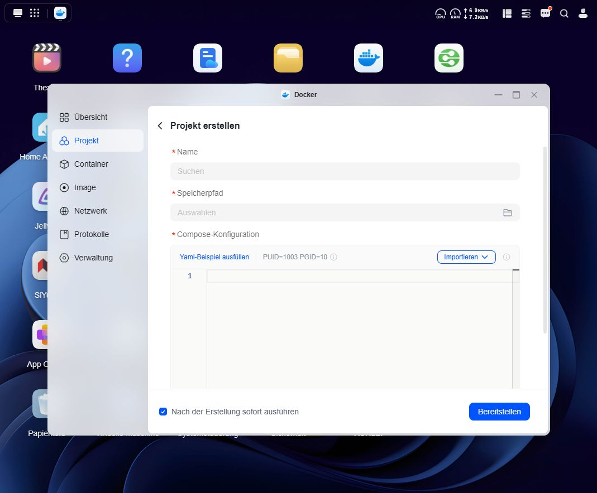
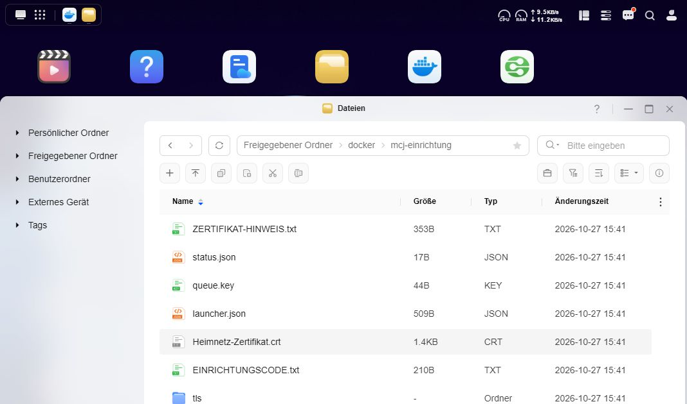
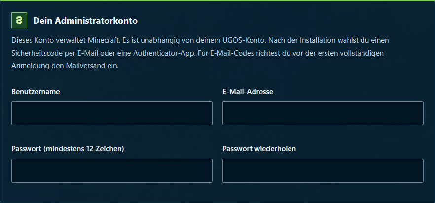
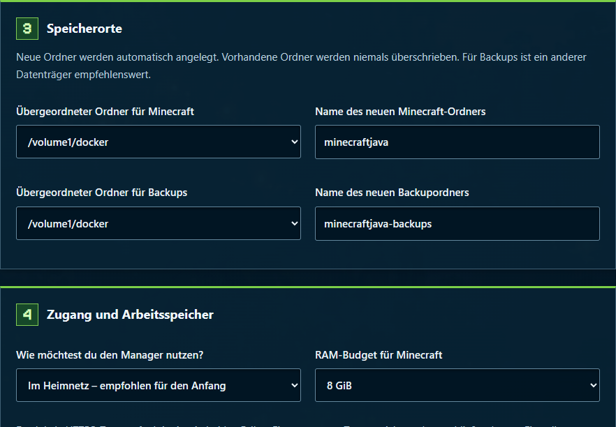
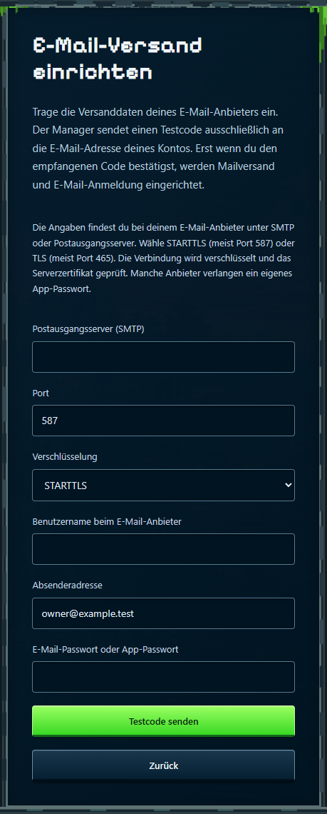
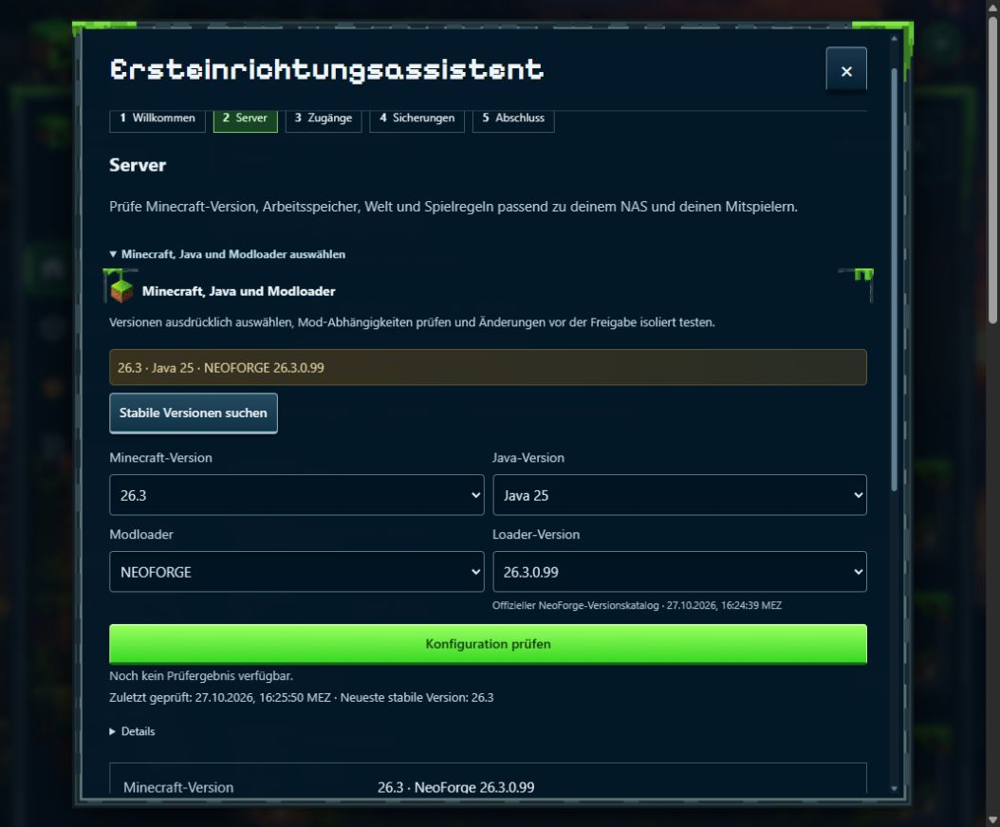

# MCJ Manager

## 1. Auf dem UGREEN NAS installieren

Diese Anleitung führt dich durch eine neue Installation mit **UGOS Docker → Projekt**. Du brauchst dafür keine SSH-Verbindung und keine Konsole. Die Bilder zeigen UGOS auf einem DXP4800 Pro und die Einrichtung im Manager mit neutralen Beispielkonten.

**Stand: 12. November 2026 · Manager 1.0.2.**

Das Release-ZIP enthält die Installationsunterlagen und UGOS-Vorlagen, kein Docker-Image. UGOS lädt das Manager-Image **railsimulatornet/ugreen-nas-minecraft-java-manager:1.0.2** separat von [Docker Hub](https://hub.docker.com/r/railsimulatornet/ugreen-nas-minecraft-java-manager).

### Was du bereithältst

- UGREEN NAS mit Intel- oder AMD-Prozessor, UGOS und installierter Docker-App. Die Anwendung ist für linux/amd64 gebaut.
- Die feste Heimnetz-IP deines NAS, zum Beispiel **192.168.1.50**. Verwende in allen Schritten deine eigene Adresse.
- Einen vorhandenen Docker-Ordner, zum Beispiel **/volume1/docker**, sowie Platz für Welt und Backups.
- Einen aktuellen Browser und eine erreichbare E-Mail-Adresse. Wähle für deine Anmeldung E-Mail-Codes oder eine Authenticator-App. Für E-Mail-Codes brauchst du die Versanddaten deines E-Mail-Anbieters; manche Anbieter verlangen ein App-Passwort.
- Internetzugang des NAS für die benötigten Images, Minecraft, Java und Versionslisten.
- Zum Mitspielen einen Computer mit Minecraft Java Edition und einen passenden Client. Jeder Spieler benötigt ein eigenes berechtigtes Minecraft-Konto. Eine Spiellizenz ist nicht Teil dieser NAS-Anwendung.

### Der Weg bis zum ersten Spiel

1. Einrichtungsprojekt in UGOS anlegen.
2. Öffentliches Heimnetz-Zertifikat vertrauen und Einrichtungscode öffnen.
3. Administratorkonto, neue Ordner und RAM festlegen; Installation starten.
4. Anmelden, E-Mail-Code oder Authenticator-App einrichten und Wiederherstellungscodes sichern.
5. Versionen, Spieler und Backups prüfen.

**Schon installiert?** Verwende die Aktualisierung in Kapitel 15. Starte die Erstinstallation niemals über einer bestehenden Installation.

## 2. UGOS-Docker-Projekt anlegen

1. Lade die [Einrichtungsvorlage ugos-einrichtung.yaml](https://github.com/Railsimulatornet/UGREEN-NAS-Minecraft-Java-Manager/releases/download/v1.0.2/ugos-einrichtung.yaml) herunter. Sie ist auch im Installationspaket enthalten. Öffne **UGOS → Docker → Projekt → Erstellen**.
2. Vergib den Namen **mcj_einrichtung**. Wähle einen eigenen, leeren Speicherordner für dieses UGOS-Projekt. Im Beispiel ist das **/volume1/docker/mcj_einrichtung** mit Unterstrich.
3. Importiere diese YAML-Datei oder füge ihren Inhalt in die Compose-Konfiguration ein. Verwende weder eine gespeicherte GitHub-HTML-Seite noch die Datei compose.yaml aus dem Projektstamm.
4. Trage NAS_IP und NAS_ORDNER in den Variablenfeldern ein, falls deine UGOS-Version diese anbietet. Ohne Variablenfelder ersetzt du die Ausdrücke direkt in der Konfiguration, wie unten gezeigt.
5. Kontrolliere die Angaben und wähle **Bereitstellen**. Das Projekt muss anschließend laufen; wähle gegebenenfalls **Starten**.

<!-- crop: 85,150,900,630 -->

### Wenn UGOS kein Variablenfeld zeigt

Ersetze in der ports-Zeile den gesamten Ausdruck **${NAS_IP:?Private IPv4-Adresse des NAS eintragen}** durch deine NAS-IP. Aus der Zeile wird zum Beispiel: **ports: ["192.168.1.50:8090:8090/tcp"]**.

Ersetze in der ersten volumes-Zeile sowohl **${NAS_ORDNER:?Vorhandenen Docker-Ordner eintragen}** als auch **${NAS_ORDNER}** durch denselben vorhandenen Ordner. Das Ergebnis ist zum Beispiel **- "/volume1/docker:/volume1/docker"**. Andere Zeilen bleiben wie in der Vorlage.

**Wichtig:** Der Projekt-Speicherordner ist nicht der spätere Minecraft-Datenordner. Den Minecraft-Datenordner niemals als Speicherort eines neuen UGOS-Projekts auswählen.

## 3. Zertifikat und Einrichtungscode

Öffne **UGOS → Dateien → dein Docker-Ordner → mcj-einrichtung**. Dieser vom Installer angelegte Ordner hat einen Bindestrich. Er ist vom UGOS-Projektordner mcj_einrichtung mit Unterstrich zu unterscheiden.

### Dem lokalen HTTPS-Zertifikat vertrauen

1. Lade ausschließlich **Heimnetz-Zertifikat.crt** herunter. Vergleiche den SHA-256-Fingerabdruck mit **ZERTIFIKAT-HINWEIS.txt** im selben NAS-Ordner. Eine genaue Windows-Prüfung steht in der [HTTPS-Anleitung](https://github.com/Railsimulatornet/UGREEN-NAS-Minecraft-Java-Manager/blob/main/docs/HTTPS.md).
2. Windows: Zertifikat öffnen → **Zertifikat installieren → Aktueller Benutzer → Alle Zertifikate in folgendem Speicher speichern → Vertrauenswürdige Stammzertifizierungsstellen**. Importiere nur das Zertifikat deiner Installation.
3. Firefox kann einen eigenen Speicher benutzen: **Einstellungen → Datenschutz & Sicherheit → Zertifikate anzeigen → Zertifizierungsstellen → Importieren**. Auf dem Smartphone verwendest du die Zertifikatverwaltung deines Geräts beziehungsweise Browsers.
4. Öffne **https://DEINE-NAS-IP:8090/** erneut. Die Adresse muss zu der im Projekt eingetragenen IP passen. Die Browser-Zertifikatsprüfung bleibt eingeschaltet.

### Einrichtung öffnen

Öffne **EINRICHTUNGSCODE.txt** im UGOS-Dateimanager, kopiere den zeitlich begrenzten Code in das Feld **Einrichtungscode** und wähle **Einrichtung öffnen**. Behandle den Code vertraulich. Private Schlüssel und andere interne Dateien brauchst du nicht herunterzuladen.

Mehr Details: **docs/HTTPS.md**. Dein Browser kann einen eigenen Zertifikatspeicher verwenden; ein Vertrauen in Firefox gilt deshalb nicht automatisch auch in einem anderen Browser.

## 4. Dein Administratorkonto

Wähle oben die Sprache **Deutsch / English**. Lege dann deinen Benutzernamen, deine E-Mail-Adresse und ein neues, eigenes Passwort fest. Wiederhole das Passwort im Bestätigungsfeld.

Das ist dein Konto für die Weboberfläche des Managers. Es ist vom Minecraft-Spielerkonto getrennt. Deine Mitspieler brauchen kein Webkonto, um mitzuspielen.

Verwende eine E-Mail-Adresse, auf deren Postfach du zugreifen kannst. Nach der Installation wählst du E-Mail-Codes oder eine Authenticator-App. Für E-Mail-Codes richtest du den Mailversand vor dem ersten vollständigen Zugang zum Manager ein. Dabei bestätigst du einen Testcode aus deinem eigenen Postfach.

### Diese Angaben bleiben privat

- Dein Passwort und die späteren Wiederherstellungscodes gehören in deinen Passwortmanager oder an einen anderen sicheren Ort.
- Veröffentliche keine Screenshots mit Passwort, Authenticator-QR-Code, Einrichtungscode oder Webhook-Token.
- Ein normaler Supportbericht braucht nur Version, betroffene Seite, Fehlermeldung und nachvollziehbare Schritte.

**Noch nicht starten:** Prüfe auf der gleichen Seite zuerst die Speicherordner und den Arbeitsspeicher. Das folgt auf der nächsten Seite.

## 5. Ordner, Arbeitsspeicher und Installation

Verwende neue, freie Unterordner im ausgewählten Docker-Ordner. Die Vorgaben für Minecraft und Backups kannst du für eine neue Installation normalerweise übernehmen.

**GiB** ist die angezeigte Speichereinheit. Das **RAM-Budget für Minecraft** umfasst Minecraft samt Reserve. Bei **8 GiB** sind im gezeigten Beispiel **6 GiB für Java** vorgesehen. Lass zusätzlich Speicher für UGOS und andere laufende Apps frei.

Lies die **Minecraft-EULA** und bestätige sie nur, wenn du zustimmst. Kontrolliere Konto, Ordner und RAM. Klicke dann selbst auf **Installation starten**.

## 6. Warten, anmelden und Zugang absichern

Die Installation lädt die benötigten Bestandteile herunter und richtet die Dienste ein. Das kann je nach NAS und Internetverbindung mehrere Minuten dauern. Der Prozentwert zählt abgeschlossene Schritte; er misst nicht die verbleibende Zeit.

### Wenn der Übergang zur Anmeldung stockt

- Starte die Installation nicht erneut, nur weil der Browser beim gleichen Prozentwert bleibt.
- Prüfe das Einrichtungsprojekt-Protokoll in UGOS. Der Einrichtungscontainer darf nach einer erfolgreichen Übergabe beendet sein. Manager, Steuerungsdienst und Minecraft laufen danach als eigene Container.
- Öffne den angebotenen Link zum Manager oder **https://DEINE-NAS-IP:8090/** in einem neuen Tab. Kontrolliere zuerst das Zertifikatsvertrauen im betroffenen Browser.
- Ein fehlgeschlagener Browserübergang beweist nicht, dass die NAS-Installation fehlgeschlagen ist. Wenn ein neuer Tab funktioniert, kannst du den alten Tab schließen.

### Deine Anmeldemethode wählen

Melde dich mit deinem neuen Administratorkonto an. Wenn du noch ein Startpasswort verwendest, ändere es zuerst. Unter **Zugang zusätzlich schützen** wählst du **E-Mail-Sicherheitscode** oder **Authenticator-App (TOTP)**. Du brauchst nur eine dieser beiden Methoden.

### Authenticator-App verwenden

Wähle **Authenticator-App (TOTP)**, scanne den QR-Code mit deiner App und bestätige den aktuellen sechsstelligen Code. Bei einer Ablehnung prüfe die automatische Uhrzeit von Smartphone und NAS und verwende einen frischen Code. Über **Zurück** kannst du stattdessen E-Mail wählen.

## 6.1. E-Mail-Codes beim ersten Start einrichten

1. Wähle **E-Mail-Sicherheitscode**. Ist noch kein Mailversand eingerichtet, öffnet sich **E-Mail-Versand einrichten**.
2. Übernimm **Postausgangsserver (SMTP)**, Port und Benutzername aus den Versanddaten deines E-Mail-Anbieters. Verwende die von ihm genannte **Absenderadresse**.
3. Wähle **STARTTLS** (meist Port 587) oder **TLS** (meist Port 465). Die Verbindung wird verschlüsselt und das Serverzertifikat geprüft. Gib dein E-Mail-Passwort oder das vom Anbieter verlangte App-Passwort ein.
4. Wähle **Testcode senden**. Der Code geht ausschließlich an die E-Mail-Adresse deines Administratorkontos. Die Versanddaten werden erst nach deiner Codebestätigung übernommen.

<!-- crop: 25,430,410,690 -->

## 6.2. Empfang bestätigen und Codes sichern

### Wenn du E-Mail gewählt hast

Öffne dein Postfach und gegebenenfalls den Spamordner. Gib den sechsstelligen Testcode im Manager ein und wähle **Bestätigen**. Der Code gilt einmalig für **10 Minuten**. Erst der passende Code bestätigt den Empfang und schaltet die E-Mail-Anmeldung frei. Die Annahme durch den Mailserver allein reicht dafür nicht.

Kein Code angekommen? Lies die Meldung im Manager. Prüfe Servername, Port, Verschlüsselung und die Zugangsdaten deines E-Mail-Anbieters. Über **Maildaten bearbeiten und neuen Code senden** kannst du korrigieren und erneut senden; das Passwort gibst du neu ein. Nach fünf falschen Codeeingaben brauchst du einen neuen Code. Über **Zurück** erreichst du wieder die Methodenauswahl und kannst die Authenticator-App verwenden. Nach zu vielen Versandversuchen warte zehn Minuten.

### Für beide Methoden

Sichere die angezeigten **Wiederherstellungscodes** getrennt von deinem Passwort. Jeder funktioniert einmal, wenn du deinen üblichen Sicherheitscode nicht bekommst. Sie werden nur jetzt vollständig angezeigt. Bestätige erst danach **Codes gesichert · weiter**.

Bei einer späteren Anmeldung verwendest du dein Passwort und den Code der gewählten Methode. Bei E-Mail erhältst du den Code nach der Passwortprüfung. Falls der Mailversand ausfällt, kannst du auf der Code-Seite **Wiederherstellungscode verwenden** wählen; die Sicherheitsabfrage wird nicht übersprungen.

### 2FA-Methode später ändern

Öffne über deinen Anfangsbuchstaben das **Benutzerprofil → Meine 2FA-Anmeldung**. Dort steht die aktive Methode. Wähle **2FA-Methode ändern**, richte die gewünschte Methode ein und bestätige ihren Code. Bis zur erfolgreichen Bestätigung bleibt die bisherige Methode gültig; du kannst den Dialog abbrechen. Danach werden andere Sitzungen abgemeldet. Sichere die neu angezeigten Wiederherstellungscodes: Die bisherigen Codes funktionieren dann nicht mehr.

**Erfolgreich eingerichtet:** Die Übersicht zeigt den Serverzustand und der Ersteinrichtungsassistent öffnet sich. Ein gültig angemeldetes Konto braucht für normale berechtigte Einstellungen keine weitere 2FA-Abfrage.

## 7. Minecraft und Java auswählen

Im Ersteinrichtungsassistenten zeigt **1 Willkommen** den installierten Stand. In **2 Server** kannst du Minecraft, Java und den Modloader auswählen. Fabric, Forge und NeoForge sind Modloader: Sie laden die Mods für deinen Minecraft-Server. Wähle einen davon und achte darauf, dass auch Minecraft, Java und deine Mods dazu passen. Der passende Besucherschutz (Visitor Guard) wird mitgeliefert.

1. Wähle **Minecraft-Version**, **Java-Version**, **Modloader** und die dazu passende **Loader-Version**.
2. Fehlen Minecraft-Versionen, wähle **Stabile Versionen suchen** und prüfe die Internetverbindung des NAS. Für Loader-Versionen gibt es eine eigene Versionssuche.
3. Wähle **Konfiguration prüfen**. Eine Auswahl ist noch keine Übernahme und noch kein Neustart.
4. Merke die passende Änderung vor. Unter **Gesammelte Änderungen** prüfst du die Zusammenstellung und wählst den Zeitpunkt der Übernahme. Dabei werden Sicherung und Servertest ausgeführt.

Die Installation startet mit **Minecraft 26.3, NeoForge 26.3.0.99 und Java 25**. Abgenommen sind außerdem diese Kombinationen mit Besucherschutz:

- **Minecraft 1.20.1 / Java 17:** Fabric 0.20.1, Forge 47.4.28 oder NeoForge 47.1.106.
- **Minecraft 1.21.1 / Java 21:** Fabric 0.20.1, Forge 52.1.20 oder NeoForge 21.1.265.
- **Minecraft 26.3 / Java 25:** Fabric 0.20.1, Forge 66.1.0 oder NeoForge 26.3.0.99.

Die Kompatibilitätsanleitung nennt die passenden Schutzdateien und den geprüften Modbestand. Zusätzliche Mods benötigen ihre eigene Prüfung. Verwende bei einem Versionswechsel eine eigene Welt, damit die bisherige erhalten bleibt. Eine neuere Welt lässt sich nicht unbedingt mit einer älteren Minecraft-Version öffnen.

Über **Server-Einstellungen**, **Welten** und **Spielregeln** erreichst du weitere Optionen. Mit **Zurück zur Einrichtung** kehrst du in den Assistenten zurück. Du kannst ihn auch später fortsetzen.

## 8. Spieler und Rechte

Dein Webkonto verwaltet den Server. Zum Spielen verwendest du dein Minecraft-Konto. Mitspieler brauchen kein Konto für die Verwaltungsoberfläche.

### Wer darf beitreten?

Zu Beginn dürfen nur Minecraft-Konten auf der Namensliste (Whitelist) beitreten. Für das erste Konto öffnest du in der **Übersicht** die **Serverkonsole**. Trage im Feld **Minecraft-Befehl** beispielsweise **whitelist add DeinSpielername** ein und wähle **Senden**. Ersetze DeinSpielername durch deinen genauen Minecraft-Namen. Warte auf die Bestätigung, dass das Konto hinzugefügt wurde. Du bleibst dabei im Manager; eine SSH-Verbindung ist nicht nötig.

Die Einstellung für bislang unbekannte Spieler ist eine zusätzliche Entscheidung. Sie lässt sich erst einschalten, wenn der Manager den passenden Besucherschutz als geprüft erkennt. Wird die Freigabe abgelehnt, lies den Hinweis zur Schutzkomponente; verwende bis dahin die Namensliste.

### Besucher freigeben

1. Tritt nach der Namensfreigabe dem Minecraft-Server bei. Der Manager kann das Konto danach unter **Übersicht → Spieler** anzeigen. Die Spieladresse steht in Kapitel 11.
2. Suche deinen Minecraft-Namen und wähle **Aktionen**. Prüfe, dass es das richtige Konto ist.
3. Wähle unter **Gruppe** die Rolle **Spieler** und klicke auf das zugehörige **Speichern**. Die Rolle **Besucher** erlaubt zunächst nur das Zusehen.
4. Öffne **Aktionen** erneut. Prüfe für den Betrieb mit Namensliste auch **Whitelist** und speichere diesen Abschnitt. Rolle und Namensfreigabe sind getrennte Einstellungen.
5. Prüfe nach dem nächsten Beitritt, ob das Konto wie gewünscht mitspielen kann.

Operatorrechte erlauben weitreichende Minecraft-Befehle. Vergib sie nur, wenn die Person diese Befehle tatsächlich benötigt. Eine Spielfreigabe allein erfordert keine Operatorrechte.

## 9. Backups verstehen und prüfen

Unter **Einstellungen → Zeitpläne** kannst du automatische Sicherungen, Intervall und Aufbewahrung ändern. Im Einrichtungsassistenten findest du dieselben Angaben im Schritt **Sicherungen**. Wähle Werte passend zu Spielbetrieb und freiem Speicher.

### Warum wartet ein fälliges Backup?

Das Intervall bestimmt, wann eine automatische Sicherung fällig wird. Der automatisch angelegte Auftrag wartet danach auf fünf Minuten ohne Spieler. Ein belegter Server oder ein unbekannter Spielerstatus kann die Ausführung verzögern. Den Grund und den Auftragsstatus findest du unter **Übersicht → Wartung**.

Prüfe deshalb auch das Datum des letzten erfolgreich erstellten Backups. Ein fälliger oder wartender Auftrag ist noch keine neue Sicherung.

### Aufbewahrung und Löschen

Nach einer erfolgreichen Sicherung entfernt der Manager Archive, die älter als die eingestellte Aufbewahrung sind. Das gilt auch für Sicherungen vor früheren Mod- und Versionsänderungen sowie für bereits wiederhergestellte Sicherungen. Verweise im Verlauf verlängern die Aufbewahrung nicht unbegrenzt.

Die zwei neuesten tatsächlich vorhandenen Archive bleiben bei der automatischen Bereinigung erhalten. Auch Sicherungen, die ein vorgemerkter oder laufender Wiederherstellungs- oder Versionsauftrag benötigt, bleiben geschützt. Die kleinen Verlaufseinträge und JSON-Dateien bleiben als Nachweis erhalten; sie enthalten nicht das vollständige Backup. Private Rückfallverzeichnisse und Images werden durch diese Archivbereinigung nicht gelöscht.

Mit **Löschbare Einträge auswählen** wählst du nur verfügbare, ungeschützte Archive aus. **Auswahl löschen** zeigt zuerst die Anzahl und den Speicherplatz an. Erst deine Bestätigung löscht die ausgewählten Dateien.

### Eine Sicherung prüfen

1. Öffne **Backups** und erstelle ein Backup.
2. Warte auf den erfolgreichen Abschluss. Prüfe Datum und Größe des fertigen Eintrags.
3. Wähle beim Eintrag **Wiederherstellung testen**.
4. Lies das Testergebnis. Beim isolierten Test wird eine getrennte Kopie gestartet; deine aktive Welt wird dabei nicht ersetzt.

Eine Archivprüfung prüft, ob das gespeicherte Archiv lesbar ist und zu seiner Prüfsumme passt. Der Wiederherstellungstest prüft zusätzlich, ob die gesicherten Serverdaten in der getrennten Umgebung starten. Bewahre wichtige Sicherungen zusätzlich außerhalb dieses NAS auf.

Die Sicherung enthält Minecraft-Serverdaten einschließlich Welt und Mods. Sie ersetzt kein Backup der Manager-Konten und Schlüssel oder des gesamten NAS. Manager-Datenbank und **manager/secrets** musst du zusätzlich gemeinsam sichern; Einzelheiten stehen in der Administrationsanleitung.

War der Spielserver vor der Sicherung gestartet, wird er danach wieder gestartet. Ein bereits gestoppter Server bleibt gestoppt. Die Unterbrechung hängt von der Datenmenge und der Leistung des NAS ab.

Die tatsächliche Wiederherstellung wählst du ausdrücklich als eigene Aktion. Kontrolliere vorher, welches Backup und welche Welt betroffen sind.

## 10. Mods prüfen und aktivieren

**Mods → Updates prüfen** sucht nach neueren Versionen. Die Meldung **Updates noch nicht gesucht** bedeutet, dass für diese Mod noch kein aktuelles Suchergebnis vorliegt. Die Angaben **Installiert** und **Aktiv** beschreiben dagegen den Serverzustand.

### Eine Änderung übernehmen

1. Wähle eine passende Version oder lade die JAR-Datei hoch.
2. Lies Hinweise zu Minecraft-Version, Modloader und Abhängigkeiten.
3. Prüfe unter **Gesammelte Änderungen**, welche Mods hinzugefügt, aktualisiert, aktiviert oder entfernt werden sollen.
4. Wähle den Zeitpunkt der Übernahme. Der Manager führt den Auftrag mit Sicherung und getrenntem Servertest aus.
5. Warte auf den Abschluss und kontrolliere danach den tatsächlich installierten Stand.

Eine hochgeladene oder vorgemerkte Datei wird zunächst vorbereitet. Ihre Auswahl allein schaltet sie noch nicht auf dem laufenden Server ein.

### Einer hochgeladenen Mod ihre Quelle zuordnen

Öffne **Mod- und Modpack-Quellen → Quellen bearbeiten** und füge die HTTPS-Adresse der genauen Dateiversion auf CurseForge oder Modrinth hinzu. Speichere und wähle bei dieser Quelle **Dateien vormerken**. Stimmt die geprüfte Anbieterdatei exakt mit deiner bereits hochgeladenen Datei überein, wird ihre Herkunft ergänzt. Die installierte Datei wird dabei nicht neu übernommen. Eine ausdrücklich festgelegte Version bleibt ausgewählt, bis du sie änderst. Prüfe anschließend **Gesammelte Änderungen** auf zusätzliche Abhängigkeiten.

### Dateien im Mod-Eingangsordner

Die Ordnerprüfung findet neue Dateien im dafür vorgesehenen Eingangsordner. Das Prüfintervall und die automatische Übernahme sind getrennte Einstellungen. Aktiviere die automatische Übernahme nur bewusst und prüfe die dafür freigegebenen Dateien. Ohne diese Freigabe bleiben gefundene Änderungen zur Durchsicht vorgemerkt.

Die Ordnerprüfung ist auf **30 Minuten** voreingestellt. Die automatische Installation ist eine eigene Auswahl unter **Einstellungen → Zeitpläne**. Sie übernimmt nur die dafür freigegebenen neuen Ordner-Mods und wartet auf fünf Minuten ohne Spieler. Andere manuell gesammelte Änderungen bleiben getrennt.

Verwende für den Eingang den Ordner deiner Installation. Kopiere Dateien nicht gleichzeitig in mehrere Eingangs- und Serverordner. Für CurseForge hinterlegst du deinen eigenen API-Schlüssel unter **Einstellungen → Mod-Anbieter**.

## 11. Client für das erste Spiel

Der Minecraft-Client auf deinem PC muss zur Serverkonfiguration passen. Notiere unter **Übersicht → Server-Einstellungen** die Minecraft-Version, den Modloader, seine genaue Version und die Java-Version. Minecraft 1.20.1 verwendet Java 17, Minecraft 1.21.1 Java 21 und Minecraft 26.3 Java 25. Das vom Manager erstellte Clientpaket übernimmt die passenden Loader- und Moddateien.

### Frisch installiert und noch kein Clientpaket?

Der Besucherschutz gehört nur auf das NAS. Wenn noch keine weiteren, für Spieler geeigneten Mods vorhanden sind, erstellt der Manager kein leeres Clientpaket. Du kannst stattdessen eine passende Minecraft-Instanz in Prism Launcher anlegen. Installiere keine beliebigen Mods, nur um ein Paket erzeugen zu können.

1. Öffne Prism Launcher und melde dein Microsoft-Konto mit Minecraft-Java-Lizenz an.
2. Wähle **Instanz erstellen**. Vergib einen Namen und wähle die genaue Minecraft-Version deines Servers.
3. Wähle denselben Modloader wie auf dem NAS (**Fabric**, **Forge** oder **NeoForge**) und übernimm seine genaue Version. Fehlt die Auswahl beim Anlegen, findest du sie unter **Bearbeiten → Version**. Bei NeoForge 1.20.1 wähle ausdrücklich **NeoForge 47.1.106**, nicht Forge 47.4.28.
4. Öffne **Bearbeiten → Einstellungen → Java**. Verwende **Java 17 für 1.20.1**, **Java 21 für 1.21.1** oder **Java 25 für 26.3**. Die automatische Erkennung und der Java-Download stehen je nach Prism-Paket unter **Einstellungen → Java** zur Verfügung.
5. Starte die neue Instanz. Weitere Client-Mods brauchst du nur, wenn deine Server-Mods sie verlangen; dafür verwendest du das Clientpaket auf der nächsten Seite.

Die offiziellen Prism-Anleitungen erklären [Instanzen anlegen](https://prismlauncher.org/wiki/getting-started/create-instance/) und [Java auswählen](https://prismlauncher.org/wiki/getting-started/installing-java/). Auswahl und Bezeichnungen können sich je nach Launcher-Version unterscheiden.

### Dem Server beitreten

Im Spiel: **Mehrspieler → Server hinzufügen**. Trage die NAS-IP und den Spielport ein, zum Beispiel **192.168.1.50:25565**. Port **8090** gehört zur Browseroberfläche. Wähle **Server beitreten**. Bei geschlossener Namensliste muss dein Minecraft-Spielername vorher freigegeben sein; siehe Kapitel 8. Eine Freigabe zum Spielen erfolgt getrennt durch die Server-Admins.

## 11.1. Clientpaket für Mitspieler

### Ein Paket für deine Mitspieler erstellen

1. Öffne unter **Mods** den Bereich **Client-Modpack**.
2. Kläre unter **Welche Mods brauchen die Spieler?**, welche Mods auf den Spieler-PC gehören. Lies bei unklaren Anforderungen die Angaben des Mod-Autors.
3. Wähle **Client-Paket erstellen / aktualisieren** und warte auf den Abschluss.
4. Lade das aktuelle **.mrpack** herunter oder erstelle einen Download-Link für deine Mitspieler.

Ein Dateiname wie **1.0.2-client.2** bedeutet: erstellt mit Manager 1.0.2, Paketnummer 2. Minecraft-, Java- und Loader-Version stehen separat darunter. Ältere Pakete behalten ihren ursprünglichen Namen. Nach Serveränderungen kann ein neues Paket nötig sein.

Ein Spieler-Link gibt Zugriff auf das zugehörige Paket. Prüfe Gültigkeit und Widerruf in der Paketansicht. Ein abgelaufener oder widerrufener Link muss neu erstellt werden.

### In Prism Launcher importieren

Öffne **Instanz erstellen → Importieren** und wähle die heruntergeladene .mrpack-Datei. Gib der neuen Instanz einen verständlichen Namen. Starte diese Instanz mit deinem Minecraft-Konto und verwende die dazu passende Java-Version. Die offizielle [Prism-Anleitung zum Import](https://prismlauncher.org/wiki/help-pages/zip-import/) zeigt den Importbereich.

### Mit dem NAS verbinden

Öffne im Spiel **Mehrspieler → Server hinzufügen**. Im Heimnetz verwendest du die NAS-IP und den Spielport, zum Beispiel **192.168.1.50:25565**. Der Manager-Port **8090** ist für die Browseroberfläche bestimmt. Speichere den Eintrag und wähle **Server beitreten**. Minecraft-Version und Modloader müssen zum Server passen.

Für Mitspieler außerhalb des Heimnetzes brauchst du eine von dort erreichbare Spieladresse und den Spielport. Die private NAS-IP aus dem Beispiel ist außerhalb deines Heimnetzes nicht direkt erreichbar. Ein Web-Reverse-Proxy ist für die Minecraft-Verbindung nicht erforderlich. Richte die nötige Netz- und Routerkonfiguration getrennt ein und aktiviere die Minecraft-Freigabe im Manager bewusst; interne Steuerungsports bleiben geschlossen.

Wenn die Verbindung scheitert, prüfe Serverstatus, Namensliste, Minecraft-Version und benötigte Client-Mods. Die offizielle [Minecraft-Anleitung für Mehrspieler](https://www.minecraft.net/en-us/article/how-play-minecraft-server) erklärt den Verbindungsdialog.

## 12. Welten und verwendeter Seed

Unter **Einstellungen → Welten** siehst du vorhandene Welten, ihre Größe und die aktive Welt. Bei gespeicherten Welten zeigt der Manager den Seed aus der Weltdatei an. **Nicht auslesbar** bedeutet, dass der Wert nicht sicher ermittelt werden konnte.

Ein Seed kann negativ und sehr lang sein. Kopiere ihn vollständig, einschließlich des Minuszeichens. Das Feld **Welt-Seed (optional)** unter **Neue Welt oder Import** legt den Seed einer neuen Welt fest.

### Neue oder importierte Welt verwenden

1. Vergib einen neuen Weltnamen. Verwende Buchstaben, Ziffern, Unterstrich oder Bindestrich.
2. Gib bei einer neuen Welt bei Bedarf Seed und Generierung an. Für einen Import wählst du stattdessen das passende Welt-ZIP.
3. Bereite die Welt vor und prüfe anschließend die vorgemerkte Änderung.
4. Wähle den Zeitpunkt des Wechsels und kontrolliere nach dem Auftrag die aktive Welt.

Ein Weltwechsel braucht eine bewusste Übernahme. Exportiere wichtige Welten zusätzlich als ZIP und bewahre Backups auf. Lösche eine alte Welt erst, wenn du die richtige Welt eindeutig erkannt und ihre Sicherung geprüft hast.

Für eine andere Minecraft-Version verwendest du eine eigene, kompatible Welt. Eine mit neuerem Minecraft gespeicherte Welt lässt sich nicht beliebig auf einer älteren Version starten. Die Versionsprüfung kann einen solchen Wechsel ablehnen.

## 13. Discord, Mail und Begrüßung

### Discord einrichten

Öffne **Einstellungen → Discord**, aktiviere den Dienst und trage den Webhook aus dem gewünschten Discord-Kanal ein. Wähle Sprache und Ereignisse. Klicke auf **Speichern** und danach auf **Discord testen**.

Prüfe im ausgewählten Kanal, ob die Testmeldung angekommen ist. Der Webhook enthält einen geheimen Schlüssel. Über **Webhook anzeigen** kannst du die gespeicherte Adresse kontrollieren; blende sie anschließend wieder aus. Offizielle HTTPS-Adressen mit **/api/webhooks/** und **/api/v10/webhooks/** werden unterstützt.

### Mailversand verwalten

Wenn du beim ersten Login einen E-Mail-Code bestätigt hast, sind diese Daten bereits eingerichtet. Du brauchst sie nicht noch einmal einzugeben.

Unter **Einstellungen → E-Mail-Versand** trägst du Server, Benutzername, Passwort und Absender nach den Angaben deines Mailanbieters ein. Verwende die dazu passende verschlüsselte Verbindung, beispielsweise STARTTLS mit Port 587 oder TLS mit Port 465. Speichere und sende anschließend eine Testmail.

Die Testmail geht an die E-Mail-Adresse deines angemeldeten Kontos. Kontrolliere Posteingang und gegebenenfalls Spamordner. Die Annahme durch den Mailserver und der sichtbare Eingang im Postfach sind zwei getrennte Prüfschritte.

Für E-Mail-Sicherheitscodes und Passwortwiederherstellung müssen die Kontoadressen erreichbar und der Mailversand korrekt eingerichtet sein.

### Begrüßungsnachrichten

Öffne **Einstellungen → Spieler begrüßen**. Lege getrennte Texte für den ersten Besuch und für die Rückkehr fest und aktiviere sie einzeln. **{player}** wird durch den Minecraft-Spielernamen ersetzt. Beispiele: **Willkommen auf dem Server, {player}!** und **Willkommen zurück, {player}!**

Prüfe beide Texte durch einen ersten Beitritt und eine erneute Verbindung. Die Begrüßung ersetzt keine Spielfreigabe.

## 14. Wartungsaufträge verfolgen

Unter **Übersicht → Wartung** findest du offene und abgeschlossene Aufträge. Öffne bei Bedarf die Details: Dort stehen die angeforderte Änderung, Startbedingung, Fortschritt und Ergebnis.

Du kannst das Wartungsfenster schließen. Bereits angenommene Aufträge laufen auf dem NAS weiter. Öffne den Bereich später erneut, um den aktuellen Stand zu sehen.

- **Wartend:** Der Auftrag ist angenommen, seine Startbedingung ist noch nicht erfüllt.
- **Wird vorbereitet / läuft:** Der Manager arbeitet am Auftrag. Warte auf das Ergebnis.
- **Erfolgreich:** Der Auftrag ist abgeschlossen. Kontrolliere bei Änderungen auch den angezeigten Serverstand.
- **Fehlgeschlagen:** Lies die konkrete Meldung und die Hinweise zum nächsten Schritt. Starte denselben Auftrag nicht mehrfach parallel.

**Jetzt ausführen** überspringt eine Wartebedingung. Ein notwendiger Serverstopp oder Neustart trennt verbundene Spieler. Prüfe daher vor der Bestätigung, welcher Auftrag betroffen ist und wer gerade spielt.

Bei geplanten Aufträgen kontrollierst du Datum, Uhrzeit und angezeigte Zeitzone. Der Abschluss des Einrichtungsassistenten bestätigt, dass du seine Schritte durchgesehen hast; vorgemerkte Wartungsaufträge können danach noch warten oder laufen.

## 15. Aktualisieren und Hilfe finden

### Spätere Manager-Versionen installieren

Nach der Erstinstallation verwendest du diesen Weg für eine spätere Manager-Version. Minecraft-Versionen, Mods und Welten verwaltest du getrennt in ihren Bereichen.

**Vor dem Update:** Manager, Steuerungsdienst und Minecraft müssen laufen und als gesund angezeigt werden. Auch ein absichtlich gestoppter Minecraft-Server blockiert das Update; starte ihn zuerst. Bei Startfehlern prüfst du die Containerprotokolle in UGOS.

1. Warte, bis laufende Wartungsaufträge abgeschlossen sind.
2. Lade das freigegebene offizielle **stable**-Image in **UGOS → Docker → Image**. Wenn dir eine Image-Datei bereitgestellt wurde, importiere stattdessen diese in UGOS.
3. Öffne das bestehende Einrichtungsprojekt, gewöhnlich **mcj_einrichtung**. Behalte dessen bisherigen Speicherordner bei.
4. Lade die [Aktualisierungsvorlage ugos-aktualisierung.yaml](https://github.com/Railsimulatornet/UGREEN-NAS-Minecraft-Java-Manager/releases/download/v1.0.2/ugos-aktualisierung.yaml) herunter. Importiere sie als Compose-Konfiguration und wähle **Neu bereitstellen**. Die Vorlage ist auch unter **Einstellungen → Manager aktualisieren** verfügbar. Starte das Aktualisierungsprojekt gegebenenfalls anschließend.
5. Lies das Ergebnis im Projektprotokoll. Der Helfer prüft den Stand, sichert die Manager-Datenbank und ersetzt Manager und Steuerungsdienst. Der Minecraft-Spielserver läuft dabei weiter. Lade danach die Manager-Webseite neu.

Ein bereits aktueller Stand wird ohne Dienstneustart bestätigt. Bei fehlgeschlagenen Gesundheits- oder Erhaltungsprüfungen meldet der Helfer den Rückfall auf den vorherigen Stand. Ein Rückfall ist kein erfolgreiches Update. Details stehen in **docs/AKTUALISIEREN.md**.

### Wenn etwas nicht klappt

- **Port 8090 belegt:** Prüfe die vorhandenen UGOS-Projekte und ihre Portbelegung. Nicht gleichzeitig einen zweiten Installer für dieselbe Adresse starten.
- **Image nicht verfügbar:** Prüfe den Image-Namen und den Downloadweg in den Versionshinweisen. Bei einem Verbindungsfehler kontrolliere die Internetverbindung des NAS und versuche es später erneut. Bestehende Container brauchst du dafür nicht zu löschen.
- **Nur eine Minecraft-Version sichtbar:** Versionssuche starten und Internetverbindung des NAS prüfen.
- **CurseForge verlangt einen API-Schlüssel:** Unter **Einstellungen → Mod-Anbieter** einen eigenen Schlüssel hinterlegen. Er gehört nicht in öffentliche Fehlerberichte.
- **Test für Discord oder Mail verweigert:** Zuerst speichern, danach testen und den Hinweis beim Testknopf lesen. Die normalen Tests verwenden die gespeicherten Einstellungen.
- **Installation oder Update fehlgeschlagen:** Protokoll und genaue Meldung sichern. Keine pauschalen rekursiven Rechteänderungen anwenden und keine Neuinstallation über den vorhandenen Daten starten.

### Weiterführende Dateien

[Kurzer Einstieg](https://github.com/Railsimulatornet/UGREEN-NAS-Minecraft-Java-Manager/blob/main/README.md) · [HTTPS und Zertifikat](https://github.com/Railsimulatornet/UGREEN-NAS-Minecraft-Java-Manager/blob/main/docs/HTTPS.md) · [UGOS-Update](https://github.com/Railsimulatornet/UGREEN-NAS-Minecraft-Java-Manager/blob/main/docs/AKTUALISIEREN.md) · [Wiederherstellung](https://github.com/Railsimulatornet/UGREEN-NAS-Minecraft-Java-Manager/blob/main/docs/INSTALL-RECOVERY.md).

Projekt: https://github.com/Railsimulatornet/UGREEN-NAS-Minecraft-Java-Manager

Unabhängiges Projekt von Roman Glos. Keine offizielle UGREEN-, Mojang- oder Microsoft-Software. Drittanbieter behalten ihre jeweiligen Lizenzen; Minecraft unterliegt seiner eigenen EULA.
