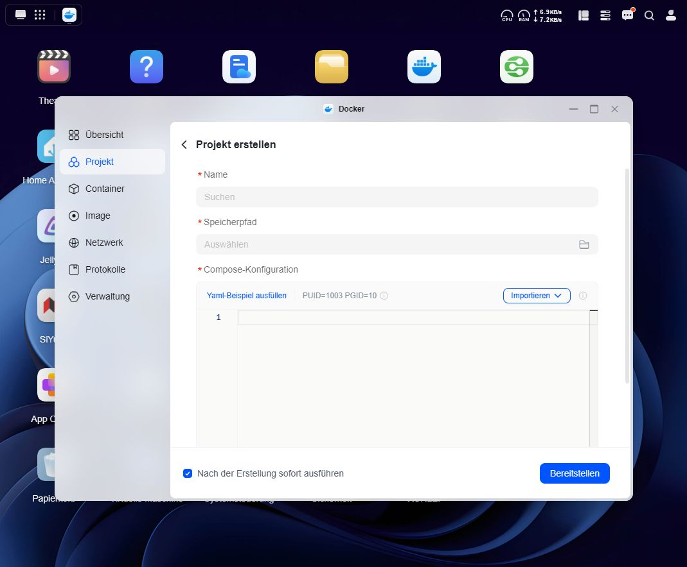
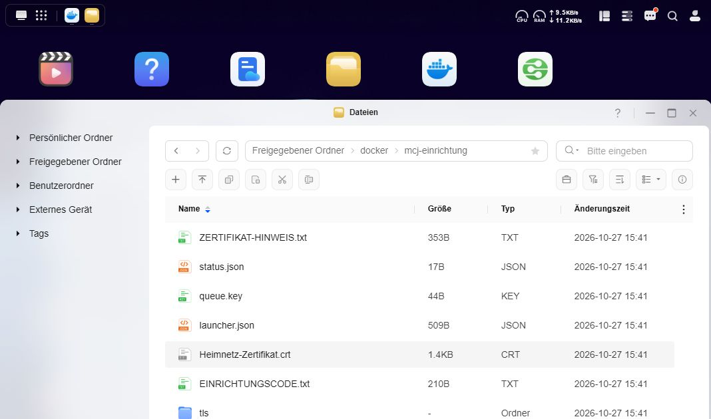
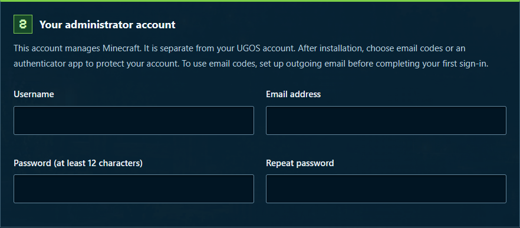
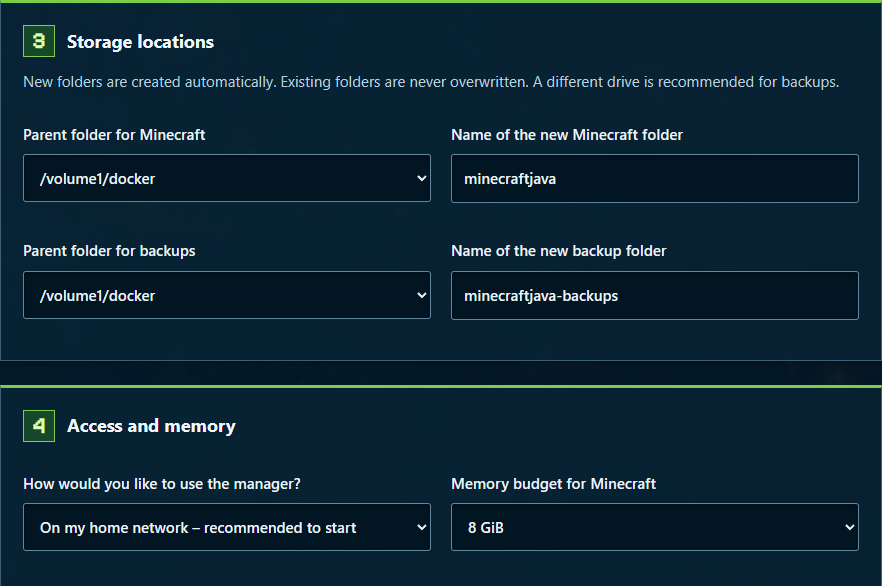
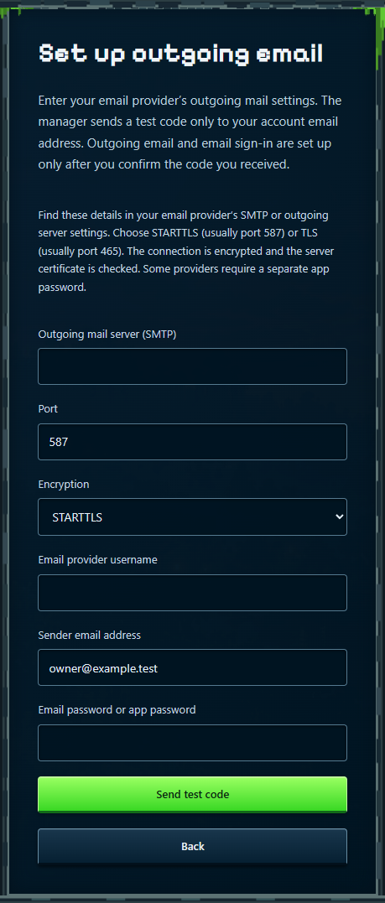
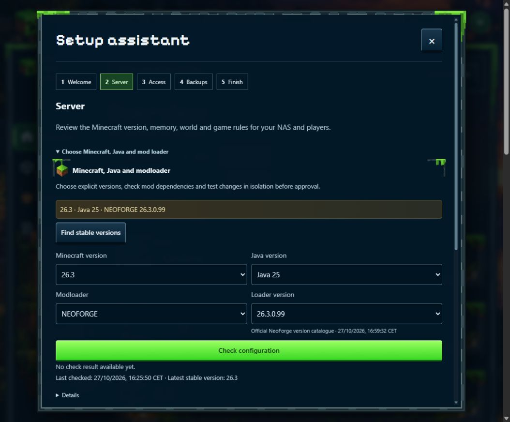

# MCJ Manager

## 1. Install on your UGREEN NAS

This guide takes you through a new installation using **UGOS Docker → Project**. You do not need SSH or a terminal. The screenshots show UGOS on a DXP4800 Pro with the German interface and the manager setup using neutral example accounts.

**Updated 12 November 2026 · Manager 1.0.2.**

The release ZIP contains the installation documents and UGOS templates, not a Docker image. UGOS downloads the manager image **railsimulatornet/ugreen-nas-minecraft-java-manager:1.0.2** separately from [Docker Hub](https://hub.docker.com/r/railsimulatornet/ugreen-nas-minecraft-java-manager).

### Have these ready

- A UGREEN Intel or AMD NAS with UGOS and its Docker app installed. The application is built for linux/amd64.
- Your NAS's fixed home-network IP address, for example **192.168.1.50**. Use your own address throughout.
- An existing Docker directory, for example **/volume1/docker**, and space for your world and backups.
- A modern browser and an email address you can access. Choose email codes or an authenticator app for sign-in. For email codes, have your provider’s outgoing mail settings ready; some providers require an app password.
- NAS internet access for images, Minecraft, Java and version catalogues.
- To play, a computer with Minecraft Java Edition and a matching client. Each player needs their own licensed Minecraft account. This NAS application does not include a game licence.

### From setup to your first game

1. Create the setup project in UGOS.
2. Trust the public local certificate and open the setup code.
3. Choose your administrator account, new directories and RAM; start installation.
4. Sign in, set up email codes or an authenticator app, and save your recovery codes.
5. Review versions, players and backups.

**Already installed?** Use the update instructions in chapter 15. Never run first-time installation over existing data.

## 2. Create the UGOS Docker project

1. Download the [setup template ugos-einrichtung.yaml](https://github.com/Railsimulatornet/UGREEN-NAS-Minecraft-Java-Manager/releases/download/v1.0.2/ugos-einrichtung.yaml). It is also included in the installation pack. Open **UGOS → Docker → Project → Create** (German: Projekt → Erstellen).
2. Name it **mcj_einrichtung**. Choose a separate, empty storage directory for this UGOS project. The example uses **/volume1/docker/mcj_einrichtung**, with an underscore.
3. Import this YAML file or paste its contents into the Compose configuration. Do not use a saved GitHub HTML page or compose.yaml from the project root.
4. Enter NAS_IP and NAS_ORDNER in the variables fields if your UGOS version offers them. Otherwise replace the expressions directly in the configuration as explained below.
5. Check the settings and choose **Deploy** (Bereitstellen). The project must then be running; choose **Start** if needed.

<!-- crop: 85,150,900,630 -->

### If UGOS has no variables field

In the ports line, replace the entire expression **${NAS_IP:?Private IPv4-Adresse des NAS eintragen}** with your NAS IP. For example, the resulting line is **ports: ["192.168.1.50:8090:8090/tcp"]**.

In the first volumes line, replace both **${NAS_ORDNER:?Vorhandenen Docker-Ordner eintragen}** and **${NAS_ORDNER}** with the same existing directory. For example: **- "/volume1/docker:/volume1/docker"**. Keep the other template lines as supplied.

**Important:** The UGOS project directory is separate from the Minecraft data directory created later. Never choose an existing Minecraft data directory as the storage location of a new UGOS project.

## 3. Certificate and setup code

Open **UGOS → Files → your Docker directory → mcj-einrichtung**. This installer-created directory has a hyphen. It is separate from the UGOS project directory mcj_einrichtung with an underscore.

### Trust the local HTTPS certificate

1. Download only **Heimnetz-Zertifikat.crt**. Compare its SHA-256 fingerprint with **ZERTIFIKAT-HINWEIS.txt** in the same NAS directory. The [HTTPS guide](https://github.com/Railsimulatornet/UGREEN-NAS-Minecraft-Java-Manager/blob/main/docs/HTTPS.md) gives a precise Windows check.
2. Windows: open the certificate → **Install Certificate → Current User → Place all certificates in the following store → Trusted Root Certification Authorities**. Import only your installation's certificate.
3. Firefox may use its own store: **Settings → Privacy & Security → View Certificates → Authorities → Import**. On a phone, use your device's or browser's certificate management.
4. Reopen **https://YOUR-NAS-IP:8090/**. The address must match the IP used in the project. Leave browser certificate verification enabled.

### Open setup

Open **EINRICHTUNGSCODE.txt** in UGOS Files, paste its time-limited code into **Setup code**, and choose **Open setup**. Keep the code private. You do not need to download private keys or other internal files.

For more detail, see **docs/HTTPS.md**. Browsers can use different certificate stores: trusting the installation in Firefox does not automatically establish trust in another browser.

## 4. Your administrator account

Use the **Deutsch / English** selector at the top. Enter your username, email address and a new password of your own. Repeat the password in the confirmation field.

This account operates the manager's web interface. It is separate from a Minecraft player account. Your players do not need web accounts to join the game.

Use an email address whose inbox you can access. After installation, choose email codes or an authenticator app. For email codes, set up outgoing mail before completing your first sign-in to the manager. You will confirm a test code from your own inbox.

### Keep these private

- Store your password and later recovery codes in your password manager or another safe place.
- Do not publish screenshots containing passwords, authenticator QR codes, setup codes or webhook tokens.
- A normal bug report needs the version, affected page, exact message and steps to reproduce.

**Before starting:** Review the storage directories and RAM on the same page. The next page explains them.

## 5. Directories, memory and installation

Use new, unused subdirectories inside your selected Docker directory. For a new installation you can normally keep the suggested Minecraft and backup locations.

**GiB** is the displayed memory unit. **Memory budget for Minecraft** includes Minecraft and a reserve. At **8 GiB**, the example assigns **6 GiB to Java**. Leave additional memory available for UGOS and your other apps.

Read the **Minecraft EULA** and accept it only if you agree. Check your account, directories and RAM, then click **Start installation** yourself.

## 6. Wait, sign in and secure access

Installation downloads the required components and creates the services. Depending on your NAS and internet connection, this can take several minutes. The percentage counts completed stages; it is not a time-remaining estimate.

### If the transition to sign-in stalls

- Do not submit installation again merely because the percentage stays the same.
- Check the setup project log in UGOS. After a successful handover, the setup container may be stopped. Manager, controller and Minecraft then run in their own containers.
- Open the offered manager link or **https://YOUR-NAS-IP:8090/** in a new tab. First check certificate trust in the affected browser.
- A failed browser handover does not prove a failed NAS installation. If a new tab works, close the old one.

### Choose your sign-in method

Sign in with your new administrator account. If you are using an initial password, change it first. Under **Protect your account**, choose **Email security code** or **Authenticator app (TOTP)**. You need only one of these methods.

### Use an authenticator app

Choose **Authenticator app (TOTP)**, scan the QR code using your app and confirm its current six-digit code. If rejected, check automatic time on your phone and NAS and use a fresh code. Choose **Back** if you prefer email instead.

## 6.1. Set up email codes on first sign-in

1. Choose **Email security code**. If outgoing mail has not been configured, **Set up outgoing email** opens.
2. Enter the **Outgoing mail server (SMTP)**, port and username from your email provider’s outgoing settings. Use the **Sender email address** specified by your provider.
3. Choose **STARTTLS** (usually port 587) or **TLS** (usually port 465). The connection is encrypted and the server certificate is checked. Enter your email password or the app password your provider requires.
4. Choose **Send test code**. The code goes only to your administrator account’s email address. These outgoing settings are saved only after you confirm the code.

<!-- crop: 25,370,410,690 -->

## 6.2. Confirm receipt and save recovery codes

### If you chose email

Open your inbox and, if needed, the spam folder. Enter the six-digit test code in the manager and choose **Confirm**. The code works once and expires in **10 minutes**. Only the correct code confirms receipt and enables email sign-in. Acceptance by the mail server alone is not enough.

No code received? Read the message in the manager. Check the server name, port, encryption and your provider’s sign-in details. Choose **Edit mail settings and send a new code** to correct the settings and retry; enter the password again. After five incorrect code attempts, you need a new code. Choose **Back** to return to method selection and use an authenticator app instead. After too many sending attempts, wait ten minutes.

### For either method

Save the displayed **Recovery codes** separately from your password. Each works once if you cannot get your usual security code. The full codes are shown only now. Then choose **Codes saved · continue**.

For later sign-ins, use your password and a code from your chosen method. Email codes are sent after your password is checked. If email delivery fails, select **Use a recovery code** on the code screen; the security check is still required.

### Change your two-factor method later

Select your initial to open **Profile → My two-factor sign-in**. Your active method is shown there. Choose **Change two-factor method**, set up the method you want and confirm its code. Your previous method stays active until confirmation succeeds; you can cancel the dialog. Other sessions are then signed out. Save the new recovery codes: your previous codes will no longer work.

**Setup is ready:** The overview shows server status and opens the setup assistant. A valid authenticated session does not require another 2FA challenge for ordinary authorised settings changes.

## 7. Choose Minecraft and Java

In the setup assistant, **1 Welcome** summarises the installed versions. **2 Server** lets you choose Minecraft, Java and the mod loader. Fabric, Forge and NeoForge are mod loaders: they load the mods used by your server. Choose one and make sure your Minecraft, Java and mod versions match it. The matching protection mod, Visitor Guard, is included.

1. Choose **Minecraft version**, **Java version**, **Mod loader** and the matching **Loader version**.
2. If Minecraft versions are missing, choose **Find stable versions** and check the NAS internet connection. There is a separate version search for the loader.
3. Choose **Check configuration**. Selecting a version does not apply it or restart the server.
4. Collect the suitable change. Review it under **Collected changes** and choose when to apply it. The process includes a backup and server test.

Installation starts with **Minecraft 26.3, NeoForge 26.3.0.99 and Java 25**. The following combinations have also been accepted with visitor protection:

- **Minecraft 1.20.1 / Java 17:** Fabric 0.20.1, Forge 47.4.28 or NeoForge 47.1.106.
- **Minecraft 1.21.1 / Java 21:** Fabric 0.20.1, Forge 52.1.20 or NeoForge 21.1.265.
- **Minecraft 26.3 / Java 25:** Fabric 0.20.1, Forge 66.1.0 or NeoForge 26.3.0.99.

The compatibility guide identifies the matching protection files and tested mod inventory. Additional mods need their own checks. Use a separate world for a version switch to preserve the previous world. A newer world may not open correctly in an older Minecraft version.

Use **Server settings**, **Worlds** and **Game rules** for further options. **Return to setup** takes you back to the assistant. You can also continue it later.

## 8. Players and permissions

Your web account manages the server. Your Minecraft account is used to play. Players do not need an account for the management interface.

### Who can join?

Initially, only Minecraft accounts on the name list (whitelist) may join. To add the first account, open **Server console** on **Overview**. In **Minecraft command**, enter **whitelist add YourPlayerName**, replacing YourPlayerName with your exact Minecraft name, and click **Send**. Wait for confirmation that the account was added. This stays inside the manager; no SSH connection is needed.

Allowing previously unknown players is a separate choice. It becomes available only when the manager recognises the matching visitor protection as verified. If this choice is refused, read the protection message and keep using the name list until it is available.

### Allow a visitor to play

1. Join the Minecraft server after name approval. The account can then appear under **Overview → Players**. Chapter 11 explains the game address.
2. Find your Minecraft name and choose **Actions**. Check that this is the correct account.
3. Under **Group**, choose **Player** and click that section’s **Save** button. **Visitor** initially allows viewing only.
4. Open **Actions** again. When using the name list, also check **Whitelist** and save that section. The role and name approval are separate settings.
5. On the next join, check that the account can play as intended.

Operator permission grants powerful Minecraft commands. Give it only to someone who needs those commands. Permission to play alone does not require operator permission.

## 9. Understand and check backups

Use **Settings → Schedules** to change automatic backups, interval and retention. The setup assistant has the same settings in its **Backups** step. Choose values that suit your play sessions and free space.

### Why is a due backup waiting?

The interval determines when an automatic backup becomes due. Its automatically created job then waits for five minutes without players. Online players or an unknown player count can delay it. Read the reason and job state under **Overview → Maintenance**.

Also check the date of the last successfully created backup. A due or waiting job is not a new backup yet.

### Retention and deletion

After a successful backup, the manager removes archives older than the configured retention period. This also applies to backups made before earlier mod or version changes and backups that have already been restored. References in the history do not keep archives indefinitely.

Automatic cleanup keeps the two newest archives that are actually present. Backups needed by a planned or running restore or version job also remain protected. Small history records and JSON files remain as a record; they do not contain the full backup. This archive cleanup does not delete private rollback directories or images.

**Select deletable items** selects only available, unprotected archives. **Delete selection** first shows the number of archives and their storage size. Files are deleted only after you confirm.

### Check a backup

1. Open **Backups** and create a backup.
2. Wait for successful completion. Check the finished entry's date and size.
3. Choose **Test restoration** for that entry.
4. Read the result. The isolated test starts a separate copy and does not replace your active world.

Archive verification checks that the saved archive is readable and matches its checksum. A restore test also checks whether the saved server can start separately. Keep additional copies of important backups outside this NAS.

The backup contains Minecraft server data, including the world and mods. It does not replace a backup of manager accounts and keys or of the whole NAS. Back up the manager database and **manager/secrets** together separately; see the administration guide for details.

A server that was running before the backup is started again afterwards. A server that was already stopped stays stopped. The interruption depends on the amount of data and NAS performance.

Restoring the active installation is a separate action that you choose explicitly. Check the selected backup and affected world before proceeding.

## 10. Check and activate mods

**Mods → Check updates** searches for newer releases. **Updates not searched yet** means that no current search result exists for that mod. **Installed** and **Active** describe its server state.

### Apply a change

1. Choose a matching release or upload its JAR file.
2. Read the Minecraft, modloader and dependency requirements.
3. Under **Collected changes**, review the mods to add, update, enable or remove.
4. Choose when to apply them. The manager runs the job with a backup and separate server test.
5. Wait for completion and check the actual installed versions afterwards.

Uploaded or selected files are prepared first. Selecting a file alone does not activate it on the running server.

### Link an uploaded mod to its source

Open **Mod and modpack sources → Edit sources** and add the HTTPS address of the exact file version on CurseForge or Modrinth. Save it and choose **Stage files** for that source. If the verified provider file exactly matches your uploaded file, its origin is added without reinstalling it. An explicitly pinned version stays selected until you change it. Then review **Collected changes** for any additional dependencies.

### Files in the mod input directory

Directory checks discover new files in the designated input directory. The check interval and automatic application are separate settings. Enable automatic application deliberately and review the files approved for it. Without that approval, discovered changes remain staged for review.

The folder-check interval defaults to **30 minutes**. Automatic installation is a separate choice under **Settings → Schedules**. It applies only newly approved folder mods and waits for five minutes without players. Other manually collected changes remain separate.

Use your installation's input directory. Avoid copying the same files into several input and live server directories. For CurseForge, add your own API key under **Settings → Mod providers**.

## 11. Client for your first game

Your PC's Minecraft client must match the server. Under **Overview → Server settings**, note the Minecraft version, mod loader, exact loader version and Java version. Minecraft 1.20.1 uses Java 17, Minecraft 1.21.1 uses Java 21, and Minecraft 26.3 uses Java 25. The manager's exported client pack supplies the matching loader and mod files.

### Fresh installation with no client pack yet?

Visitor protection belongs on the NAS only. If there are no other verified mods suitable for players, the manager does not create an empty client pack. Instead, create a matching Minecraft instance in Prism Launcher. You do not need to install arbitrary mods just to produce a pack.

1. Open Prism Launcher and sign in with a Microsoft account that owns Minecraft Java Edition.
2. Choose **Add Instance**. Give it a name and select your server's exact Minecraft version.
3. Select the same mod loader as the NAS (**Fabric**, **Forge** or **NeoForge**) and its exact version. If the choice is missing during creation, open **Edit → Version**. For NeoForge 1.20.1, select **NeoForge 47.1.106**, not Forge 47.4.28.
4. Open **Edit → Settings → Java**. Use **Java 17 for 1.20.1**, **Java 21 for 1.21.1** or **Java 25 for 26.3**. Depending on your Prism package, automatic detection and Java downloads are available under **Settings → Java**.
5. Launch the instance. Extra client mods are needed only when your server mods require them; use the client pack described on the next page for those.

The official Prism guides explain [creating instances](https://prismlauncher.org/wiki/getting-started/create-instance/) and [selecting Java](https://prismlauncher.org/wiki/getting-started/installing-java/). Available options and labels can differ between launcher versions.

### Join the server

In Minecraft, choose **Multiplayer → Add Server**. Enter the NAS IP and game port, for example **192.168.1.50:25565**. Port **8090** serves the browser interface. Choose **Join Server**. With a closed name list, your Minecraft name must be allowed first; see chapter 8. Server admins grant permission to play separately.

## 11.1. Client pack for players

### Create a pack for players

1. Open **Mods → Client modpack**.
2. Use **Which mods do players need?** to review what belongs on player PCs. Check the author's guidance when requirements are unclear.
3. Choose **Create / update client pack** and wait for completion.
4. Download the current **.mrpack**, or create a download link for your players.

A file name such as **1.0.2-client.2** means that manager 1.0.2 created pack number 2. Minecraft, Java and loader versions appear separately. Older packs keep their original names. A changed server may require a new pack.

A player link provides access to its pack. Review expiry and revocation in the pack view. Create a new link if the old one has expired or been revoked.

### Import into Prism Launcher

Open **Add Instance → Import** and choose the downloaded .mrpack file. Give the instance a clear name. Launch it with your Minecraft account and the matching Java version. The official [Prism import guide](https://prismlauncher.org/wiki/help-pages/zip-import/) shows the import area.

### Connect to your NAS

In Minecraft, open **Multiplayer → Add Server**. On your home network, use the NAS IP and game port, for example **192.168.1.50:25565**. Manager port **8090** serves the browser interface. Save the entry and choose **Join Server**. Minecraft and the modloader must match the server.

Players outside your home network need a game address and port reachable from their network. The private NAS IP in the example is not directly reachable from outside your home network. Minecraft connections do not require a web reverse proxy. Configure the required network and router access separately and explicitly enable Minecraft access in the manager; keep internal control ports closed.

If connection fails, check server status, name-list access, Minecraft version and required client mods. The official [Minecraft multiplayer guide](https://www.minecraft.net/en-us/article/how-play-minecraft-server) explains the connection screen.

## 12. Worlds and their saved seed

**Settings → Worlds** lists saved worlds, their sizes and the active world. The manager reads each saved world's seed from its world file. **Unavailable** means that the value could not be determined reliably.

A seed may be negative and very long. Copy the complete value, including its minus sign. The optional seed field under **New world or import** chooses the seed for a new world.

### Use a new or imported world

1. Enter a new world name using letters, digits, underscores or hyphens.
2. For a new world, choose a seed and generation settings if needed. For an import, select the appropriate world ZIP instead.
3. Prepare the world and review the pending change.
4. Choose when to switch, then check the active world after the job finishes.

A world switch requires an explicit application step. Also export important worlds as ZIP files and retain backups. Delete an old world only after identifying it and checking its backup.

Use a separate compatible world for another Minecraft version. A world saved by newer Minecraft cannot freely be started by an older version. The version check may reject that switch.

## 13. Discord, email and greetings

### Set up Discord

Open **Settings → Discord**, enable it and paste the webhook from the intended Discord channel. Choose the language and events. Select **Save**, then **Test Discord**.

Check that the test arrives in the chosen channel. A webhook contains a secret key. Use **Show webhook** to inspect the saved address and hide it afterwards. Official HTTPS addresses using **/api/webhooks/** and **/api/v10/webhooks/** are supported.

### Manage outgoing email

If you confirmed an email code during first sign-in, these settings are already configured. You do not need to enter them again.

Under **Settings → Email delivery**, enter the server, username, password and sender supplied by your email provider. Choose its matching encrypted connection, for example STARTTLS on port 587 or TLS on port 465. Save, then send a test message.

The test goes to your signed-in account's email address. Check the inbox and, if needed, the spam folder. Acceptance by the mail server and visible arrival in the mailbox are separate checks.

Email security codes and password recovery require reachable account email addresses and working outgoing email settings.

### Greeting messages

Open **Settings → Player greetings**. Set separate messages for first-time and returning players, and enable each independently. **{player}** is replaced with the Minecraft player name. Examples: **Welcome to the server, {player}!** and **Welcome back, {player}!**

Check both by joining for the first time and reconnecting. A greeting does not grant permission to play.

## 14. Follow maintenance jobs

**Overview → Maintenance** lists open and completed jobs. Open the details to see the requested change, start condition, progress and result.

You may close the maintenance window. Accepted jobs continue on the NAS. Reopen the section later to read their current state.

- **Waiting:** the job was accepted, but its start condition has not been met.
- **Preparing / running:** the manager is working on the job. Wait for its result.
- **Successful:** the job has finished. For changes, also check the displayed server state.
- **Failed:** read the specific message and suggested next step. Avoid starting the same job several times in parallel.

**Run now** skips a waiting condition. A necessary server stop or restart disconnects players. Before confirming, check the affected job and who is currently playing.

For scheduled jobs, review the date, time and displayed time zone. Finishing the setup assistant confirms that you reviewed its steps; pending maintenance jobs can still be waiting or running afterwards.

## 15. Updates and troubleshooting

### Install later manager versions

After first-time setup, use this procedure for a later manager version. Manage Minecraft versions, mods and worlds separately in their respective sections.

**Before updating, the manager, controller and Minecraft must all be running and shown as healthy.** Even an intentionally stopped Minecraft server currently prevents the update; start it first. If a service fails to start or become healthy, check its container logs in UGOS. Do not run first-time setup over existing data.

1. Wait until running maintenance jobs finish.
2. Download the approved official **stable** image in **UGOS → Docker → Image**. If you were supplied an image file, import that file into UGOS instead.
3. Open the existing setup project, normally **mcj_einrichtung**, keeping its original storage directory.
4. Download the [update template ugos-aktualisierung.yaml](https://github.com/Railsimulatornet/UGREEN-NAS-Minecraft-Java-Manager/releases/download/v1.0.2/ugos-aktualisierung.yaml). Import it as the Compose configuration and choose **Redeploy**. The template is also under **Settings → Update manager**. Start the update project afterwards if necessary.
5. Read the project log. The helper checks the installation, backs up the manager database and replaces manager and controller. The Minecraft game server keeps running. Reload the manager webpage afterwards.

An already current installation is confirmed without restarting services. Failed health or preservation checks cause an explicit rollback to the previous version. A rollback is not a successful update. See **docs/AKTUALISIEREN.md** for details.

### If something fails

- **Port 8090 is busy:** check existing UGOS projects and their port mappings. Do not start a second installer for the same address.
- **Image unavailable:** check the image name and download instructions in the release notes. For a connection error, check the NAS internet connection and try again later. There is no need to delete existing containers.
- **Only one Minecraft version:** run the version search and check NAS internet access.
- **CurseForge asks for an API key:** add your own key under **Settings → Mod providers**. Never include it in a public bug report.
- **Discord or email test refused:** save first, then test and read the message next to the test button. Normal tests use saved settings.
- **Installation or update failed:** keep the log and exact error. Do not apply broad recursive permission changes or run first-time setup over existing data.

### Further documentation

[Quick start](https://github.com/Railsimulatornet/UGREEN-NAS-Minecraft-Java-Manager/blob/main/README.md#english) · [HTTPS and certificates](https://github.com/Railsimulatornet/UGREEN-NAS-Minecraft-Java-Manager/blob/main/docs/HTTPS.md#english) · [UGOS updates](https://github.com/Railsimulatornet/UGREEN-NAS-Minecraft-Java-Manager/blob/main/docs/AKTUALISIEREN.md#english) · [Recovery](https://github.com/Railsimulatornet/UGREEN-NAS-Minecraft-Java-Manager/blob/main/docs/INSTALL-RECOVERY.md).

Project: https://github.com/Railsimulatornet/UGREEN-NAS-Minecraft-Java-Manager

Independent project by Roman Glos. Not official UGREEN, Mojang or Microsoft software. Third-party components retain their licences; Minecraft is subject to its own EULA.
